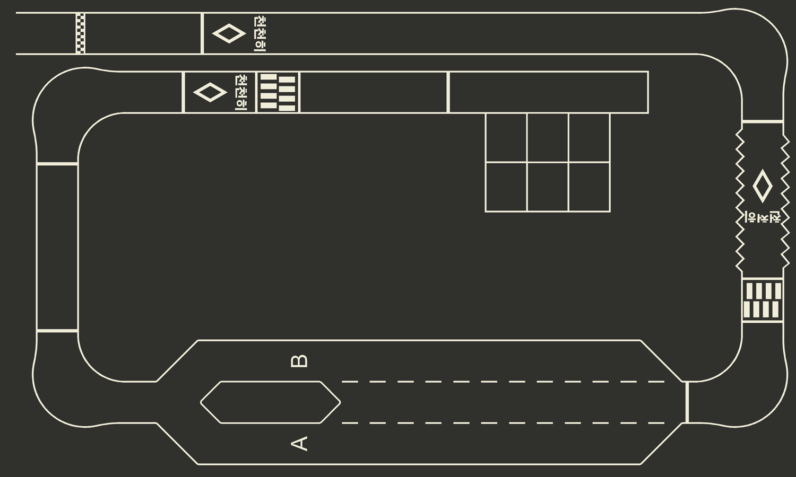

# LIMO Pro 대회 트랙 시뮬레이션

Ubuntu 24.04 + ROS 2 Jazzy + **Gazebo Harmonic 8**용 실행 환경입니다. 요청에 따라 **맵·차량·센서·수동 조작만** 제공합니다. 자율주행·차선 추종 알고리즘은 포함하지 않습니다.

도면 기준 **10 × 6 m** 노면, 공식 WEGO 메시를 사용하는 차량, 물리 바퀴/앞바퀴 조향, RGB 카메라와 IMU가 기본 구성입니다. 실차 주행 모드 확인 전이라 `ackermann`을 임시 기본값으로 두었습니다. `mode:=diff`로 차동구동 모델을 선택할 수 있습니다.



## 바로 실행

작업에 사용한 로컬 워크스페이스는 빌드되어 있습니다. GitHub에서 처음 내려받은 경우에는 아래 **새 환경 설치·빌드**를 먼저 수행하십시오. 아래 `/home/a/2026autorace`는 실제로 내려받은 경로로 바꾸십시오.

```bash
cd /home/a/2026autorace
./tools/run_sim.sh
```

다른 터미널에서 수동 주행:

```bash
cd /home/a/2026autorace
source tools/env.sh
ros2 run limo_autorace_sim teleop
```

`w`: 전진, `s`: 후진, `a`: 전진하며 좌회전, `d`: 전진하며 우회전, Space: 정지, `q`: 종료입니다. 키 입력이 0.25초 이상 끊기면 정지 명령을 보냅니다. 키를 누른 채 OS 반복 입력을 사용하거나 반복해서 누르십시오. 초기 반복 지연 동안 잠시 멈출 수 있습니다.

```bash
# GUI 없이 카메라 렌더링까지 실행
./tools/run_sim.sh gui:=false

# 차동구동 모델; 실차 모드 확인 후 선택
./tools/run_sim.sh mode:=diff

# RViz를 함께 열기
./tools/run_sim.sh rviz:=true

# 스폰 위치 변경: 도면 좌측 아래가 (0,0), 단위 m / yaw rad
./tools/run_sim.sh x:=1.6 y:=5.57 yaw:=0.0
```

동시에 같은 `ROS_DOMAIN_ID`/`GZ_PARTITION`으로 두 시뮬레이터를 실행하지 마십시오. `tools/env.sh`의 기본값은 ROS 도메인 72, Gazebo partition `autorace_local`입니다. 모든 조작·확인 터미널에서 이 파일을 source하십시오. 실차 사용 시에는 실차 도메인으로 바꿉니다.

## 카메라 화면 보기

시뮬레이터가 실행 중일 때 다른 터미널에서 다음 명령을 실행합니다.

```bash
cd /home/a/2026autorace
./tools/view_camera.sh
```

RViz의 `Front RGB`에 전방 영상이 표시됩니다. rqt를 사용하려면:

```bash
source tools/env.sh
ros2 run rqt_image_view rqt_image_view
```

상단 목록에서 `/camera/color/image_raw`를 선택하십시오. 새 터미널에서 `ros2 topic list`에 `/rosout`, `/parameter_events`만 보이면 먼저 `source tools/env.sh`로 시뮬레이터와 같은 도메인(기본 72)을 적용하십시오. RViz를 직접 구성할 때 Image의 Reliability Policy는 `Best Effort`로 설정합니다.

## 새 환경 설치·빌드

먼저 저장소를 내려받습니다. 기존 로컬 워크스페이스에서는 이 단계를 생략합니다.

```bash
git clone https://github.com/YJS906/auto.git ~/2026autorace
cd ~/2026autorace
```

ROS Jazzy가 설치된 Ubuntu 24.04 기준입니다. Classic의 `gazebo`, `gazebo_ros_pkgs`, `libgazebo_ros_*.so`를 설치하거나 실행할 필요가 없습니다.

```bash
sudo apt update
sudo apt install ros-jazzy-ros-gz ros-jazzy-xacro \
  ros-jazzy-robot-state-publisher ros-jazzy-rviz2 ros-jazzy-cv-bridge \
  ros-jazzy-rosbag2 ros-jazzy-ament-cmake-python ros-jazzy-ament-cmake-pytest \
  python3-colcon-common-extensions python3-yaml python3-numpy \
  python3-opencv python3-pil python3-pytest python3-venv poppler-utils git
cd /home/a/2026autorace
./tools/fetch_vehicle.sh
source /opt/ros/jazzy/setup.bash
colcon build --base-paths src --packages-select limo_autorace_sim --symlink-install
source tools/env.sh
```

일반 실행에는 CAD Python 라이브러리가 필요하지 않습니다. 생성된 월드와 텍스처를 포함합니다. `vendor`는 `COLCON_IGNORE`로 빌드에서 제외하며, 공식 메시 두 개만 패키지 설치 경로에 연결합니다.

## 함께 보관한 참고 자료

제공된 자료는 원래 파일명과 경로를 유지했습니다. 실제 모델 제작에 사용한 자료와 함께 전달된 자료를 구분합니다.

| 경로 | 내용 및 사용 여부 |
|---|---|
| `src/2026 국민대 LIMO 트랙 도면.zip` | 제공된 트랙 도면 원본 묶음 |
| `assets/original/` | 도면 ZIP에서 추출한 PNG·PDF·DXF·DWG. PNG·PDF·DXF는 트랙 제작과 검증에 사용했고 DWG는 원본 보존 |
| `src/첫 번째 사진.jpg` | 차량 외관 확인에 사용한 사진 |
| `src/2026-2 urop.pptx` | 함께 제공된 발표 자료, 원본 보관 |
| `src/지능.zip`, `src/지능시스템.zip` | 함께 제공된 추가 자료, 원본 보관 |

`reports/`에는 시험 결과 JSON, 로그, 스크린샷과 기록 메타데이터를 포함합니다. 대용량 rosbag 데이터(`*.mcap`, `*.db3`), 빌드·설치 결과, 가상환경은 Git에 포함하지 않습니다. 따라서 저장소의 메타데이터만으로 기존 rosbag을 재생할 수는 없습니다. 새 기록은 `tools/record.sh` 또는 반복 시험 명령으로 생성할 수 있습니다.

공식 차량 저장소는 `tools/fetch_vehicle.sh`로 지정된 커밋을 내려받습니다. 사용자 원본 자료와 외부 자산에는 신규 코드의 Apache-2.0 라이선스를 적용하지 않습니다. 출처와 구분은 [출처 문서](docs/SOURCES.md)를 참고하십시오.

## 구성과 수정 위치

```text
assets/original/                       원본 PNG, PDF, DXF, DWG
vendor/limo_pro/                       커밋 고정 공식 저장소
src/limo_autorace_sim/
  urdf/limo_sim.xacro                  차량·관절·Harmonic 플러그인
  worlds/autorace.sdf                  바닥·조명·물리 월드
  models/autorace_track/               노면 모델·텍스처
  config/vehicle.yaml                 치수·질량·마찰·조향
  config/sensors.yaml                 센서 외부 파라미터·광학·노이즈
  config/runtime.yaml                 가감속·입력 타임아웃·센서 지연
  config/interfaces.yaml              실차 토픽에 맞추는 이름 설정
  config/track.yaml                    축척·도색 색상·물리 장애물
  config/gui.config                   초기 Gazebo 시점
  launch/sim.launch.py                 전체 실행
  rviz/autorace.rviz                   TF·차량·영상 표시
tools/                                실행·기록·재생성·반복 시험
reports/                              도면 분석과 실제 실행 결과
docs/                                 모델 점검·확인/미확인 항목·출처
```

`vehicle.yaml`, `sensors.yaml`, `runtime.yaml` 변경은 시뮬레이터를 재시작하면 적용됩니다. 별도 파일도 전달할 수 있습니다.

```bash
./tools/run_sim.sh vehicle_config:=/absolute/path/vehicle.yaml \
  sensor_config:=/absolute/path/sensors.yaml interfaces:=/absolute/path/interfaces.yaml
```

RGB는 기본 640×480, 수평 화각 1.2 rad, 20 Hz입니다. **사진에서 확인한 실제 센서 사양이 아닌 임시값**입니다. 깊이 카메라와 LiDAR는 `sensors.yaml`의 `enabled: true`로 추가합니다. 센서별 xyz/rpy, 발행률, 범위, 노이즈를 바꿀 수 있습니다. `runtime.yaml`에서 전달 지연을 설정하며 원래 촬영 타임스탬프는 유지합니다. 런타임 파라미터를 동적으로 재설정하는 기능은 없으므로 파일 수정 후 재시작하십시오.

## 트랙 재생성

```bash
python3 -m venv --system-site-packages .venv
.venv/bin/pip install -r tools/requirements-track.txt
.venv/bin/python tools/analyze_track.py
.venv/bin/python tools/generate_track.py
```

`track.yaml`을 바꾼 뒤 재생성하고 Gazebo를 재시작하십시오. `scale_multiplier`는 설치된 트랙의 실제 출력 배율 보정용이며 차량 크기는 함께 바뀌지 않습니다. 스폰 좌표도 새 크기에 맞춰 조정하십시오.

- DXF 좌표 변환: `x=(X−128.493923)×0.03`, `y=(Y−121.986082)×0.03` m. +X는 도면 오른쪽, +Y는 위쪽, +Z는 바닥 위쪽입니다.
- DXF `$INSUNITS=4`만 적용하면 30배 작아집니다. 개별 치수 `DIMLFAC=30`과 PDF 10000/6000 치수로 1:30 도면 축척을 검증했습니다.
- `Visible` 레이어만 사용하고, `FD_Dimensions`, `BORDER`, 매트 외곽 사각형 핸들 4개를 제외합니다. ARC의 음의 Z extrusion도 WCS로 변환합니다.
- 5000×3000 텍스처, 2 mm/pixel. 20 mm 도색은 10 pixel입니다. 폐곡선 윤곽을 채우며 횡단보도 사이 공간과 문자 구멍을 보존합니다. 체크무늬의 밝고 어두운 교대는 제공 PNG를 참고합니다.
- 도로 경계·중앙 분리 모양·격자·지그재그도 **평면 도색**입니다. 노면 모델에 충돌 형상은 없습니다. 실제 구조물의 높이/재질이 확인되면 `obstacles`에 명시적으로 추가합니다.
- A/B·격자의 임무와 통행 방향은 지정하지 않았습니다. 기본 스폰 방향은 수동 시험 편의를 위한 방향입니다.
- 색상은 임시입니다. CAD 원본에는 모든 선이 같은 레이어 색이며 PNG도 촬영 색상 보정 자료가 아닙니다.

## ROS 제어·센서 인터페이스

| 토픽 | 메시지 | 의미 |
|---|---|---|
| `/cmd_vel` | `geometry_msgs/msg/Twist` | `linear.x` m/s, `angular.z` 요레이트 rad/s |
| `/odom` | `nav_msgs/msg/Odometry` | 관절 기반 주행계, `odom → base_link` |
| `/joint_states` | `sensor_msgs/msg/JointState` | 물리 관절 회전/조향 상태 |
| `/camera/color/image_raw` | `sensor_msgs/msg/Image` | RGB, `camera_optical_frame` |
| `/camera/color/camera_info` | `sensor_msgs/msg/CameraInfo` | 같은 해상도·촬영 시각·optical frame |
| `/imu` | `sensor_msgs/msg/Imu` | `imu_link` |
| `/scan` | `sensor_msgs/msg/LaserScan` | 선택 LiDAR, `laser_link` |
| `/camera/depth/image_raw` | `sensor_msgs/msg/Image` | 선택 깊이 영상 |
| `/clock` | `rosgraph_msgs/msg/Clock` | Gazebo 시뮬레이션 시간 |
| `/evaluation/ground_truth` | `nav_msgs/msg/Odometry` | 검증 전용 실제 시뮬레이션 pose, world 좌표 |

`/cmd_vel`, `/odom`, `/imu`는 공식 드라이버 소스에서 확인했습니다. 실제 차량에서 실행 중인 구성은 확인하지 못했으며 카메라/스캔 이름은 임시 인터페이스입니다. 비활성 선택 센서의 토픽 이름은 브리지 때문에 보일 수 있지만 메시지는 발행되지 않습니다.

아커만에서 `δ=atan(L·ω/v)`로 변환합니다. 조향각(rad)을 Twist의 요레이트 필드에 넣지 마십시오. 정지 상태 제자리 회전은 수행하지 않습니다. 기본 속도 한계 0.6 m/s, 중앙 조향각 한계 0.4 rad, 입력 끊김 0.35 s 후 감속 정지입니다. 제한과 응답은 임시값입니다. `/sim/cmd_vel`은 시뮬레이터 내부 제한 후 명령입니다.

```bash
source tools/env.sh
# 10 Hz로 전진; Ctrl-C 후 타임아웃으로 감속 정지
ros2 topic pub -r 10 /cmd_vel geometry_msgs/msg/Twist \
  '{linear: {x: 0.2}, angular: {z: 0.0}}'
# 별도 명령: 전진하며 좌회전
ros2 topic pub -r 10 /cmd_vel geometry_msgs/msg/Twist \
  '{linear: {x: 0.2}, angular: {z: 0.3}}'
# 시뮬레이션 비상 정지 / 해제 후에는 새 명령 필요
ros2 service call /command_guard/emergency_stop std_srvs/srv/SetBool '{data: true}'
ros2 service call /command_guard/emergency_stop std_srvs/srv/SetBool '{data: false}'
```

`base_link`는 **후륜 차축 중심**이고 바닥에서 바퀴 반지름만큼 높습니다. 공식 모델의 차체 중심 base_link와 다르므로 실차 TF에 맞출 때 센서 외부 파라미터와 주행계 기준점을 함께 조정하십시오. `base_footprint`는 그 아래 고정 프레임입니다. optical frame은 +Z 전방, +X 영상 오른쪽, +Y 영상 아래쪽입니다.

TF 발행 책임은 `robot_state_publisher`가 차체→센서/바퀴, Gazebo 구동 플러그인 브리지가 `odom→base_link`입니다. 별도 joint_state_publisher나 EKF를 동시에 띄우지 않습니다. ground truth의 TF는 `/tf`에 연결하지 않습니다. 모든 관련 ROS 노드는 `use_sim_time=true`입니다.

## 초기화·기록·검증

**완전 초기화는 launch 터미널에서 Ctrl-C 후 같은 명령으로 재실행**합니다. 물리 위치/속도뿐 아니라 구동 플러그인의 내부 odometry와 입력 상태를 함께 초기화합니다. GUI Reset이나 `set_pose`만으로 동일 초기 상태가 된다고 가정하지 않습니다. 이 환경의 주행 제어에는 `set_pose`를 사용하지 않습니다.

```bash
# 실행 중인 시뮬레이터의 수동 명령 기반 물리/센서 검사 (차량이 움직입니다)
source tools/env.sh
ros2 run limo_autorace_sim smoke_test --output reports/manual_smoke

# 별도 domain 73에서 매번 새 서버로 2회 시험 및 기록
python3 tools/repeat_smoke.py --repeat 2 --record

# 현재 시뮬레이터 기록, Ctrl-C로 종료
./tools/record.sh

# 구조/제어 단위 검사
colcon test --packages-select limo_autorace_sim
colcon test-result --verbose
```

자동 물리 검사는 검증 전용 고정 명령 시퀀스이며 자율주행 알고리즘이 아닙니다. 명령 발행기를 여러 개 동시에 켜지 마십시오. 사용자 변경 토픽/치수에 맞춰 시험 스크립트의 기본 기대값도 조정해야 합니다. 기본 아커만용 시험이므로 차동모드에서 조향 관절 검사를 실행하지 마십시오.

rosbag에는 원본 영상도 포함되어 수십 초에 수백 MB가 될 수 있습니다. 기록 기본 토픽은 `tools/record.sh`에 명시되어 있어 실차 remapping 후 함께 수정하십시오. 재생은 시뮬레이터를 종료한 별도 도메인에서 수행하십시오. 기록된 `/clock`을 재생하는 경우 `ros2 bag play BAG`로 재생하고 추가 `--clock`을 사용하지 않습니다.

실제 실행 증거와 미검증 항목은 [검증 결과](docs/VALIDATION.md), 실측해야 할 값은 [모델 점검](docs/MODEL_AUDIT.md), 버전·라이선스는 [출처](docs/SOURCES.md)를 참고하십시오.

## 문제 해결

- **GPU**: 현재 RTX 4060은 PCI에서 보이지만 `nvidia-smi`가 실패합니다. AMD Radeon 780M의 Mesa/EGL로 headless 카메라 렌더링과 주행 시험이 성공했습니다. NVIDIA 전용 실행을 강제하지 마십시오. GPU가 없는 환경은 `LIBGL_ALWAYS_SOFTWARE=1 ./tools/run_sim.sh gui:=false`를 시도할 수 있으나 성능은 미검증입니다.
- **GUI/Wayland 문제**: `QT_QPA_PLATFORM=xcb ./tools/run_sim.sh` 또는 `gui:=false`를 사용하십시오. 첫 렌더링은 몇 초 지연될 수 있습니다.
- **차가 안 움직임**: 시뮬레이션 Play 상태, 도메인/partition 일치, 비상 정지 latch, `/clock`, 0.35초 이내 반복 명령을 확인합니다. 아커만에서 속도 0의 요레이트 명령은 제자리 회전시키지 않습니다.
- **영상이 없음**: `ros2 topic hz /camera/color/image_raw`, `reports` 또는 launch 로그, GPU EGL 지원을 확인합니다. 센서 토픽은 best effort QoS입니다. launch 없이 노드만 실행하면 `/clock`이 없어 작동하지 않습니다.
- **맵이 흰색/없음**: `GZ_SIM_RESOURCE_PATH`가 launch에서 설정되는지, `models/autorace_track/materials/textures/track.png`가 있는지 확인합니다. 현재 모델은 기본 plane의 UV를 사용하며 DAE의 재질 해석에 의존하지 않습니다.
- **경고**: `gz_frame_id`의 SDF 확장 경고는 Gazebo 센서 프레임 지정으로 실제 메시지 프레임이 시험을 통과했습니다. KDL의 root inertia 경고는 TF 계산 라이브러리 제약이며 Gazebo의 관성/접촉 계산은 유지됩니다.
- **실차 전환**: 실차 주행 모드, 드라이버 버전, `ros2 topic list -t`, `ros2 topic info /cmd_vel -v`, TF, CameraInfo를 수집하십시오. 실제 Pro 치수·조향·질량·카메라 보정 후 `vehicle.yaml`, `sensors.yaml`, `interfaces.yaml`을 수정합니다. 실차에서는 시뮬레이터 노드를 띄우지 않고 `use_sim_time=false`와 실제 드라이버를 사용합니다.

시뮬레이션 결과는 현재 가정 모델에 대한 결과이며 실차 성능을 보장하지 않습니다.
